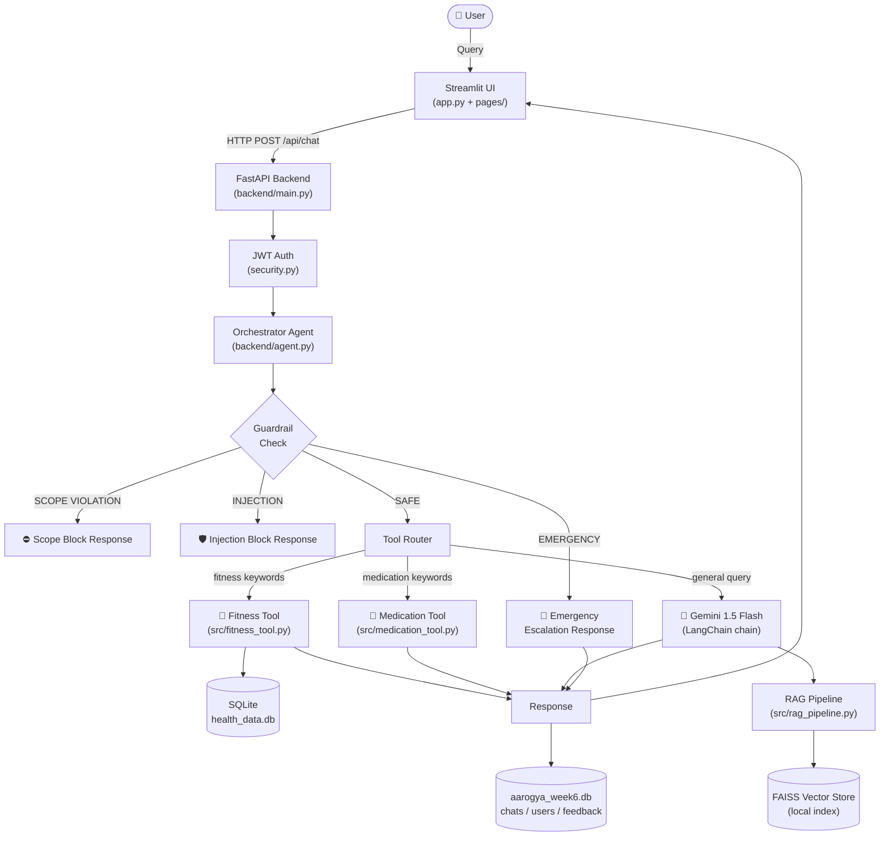
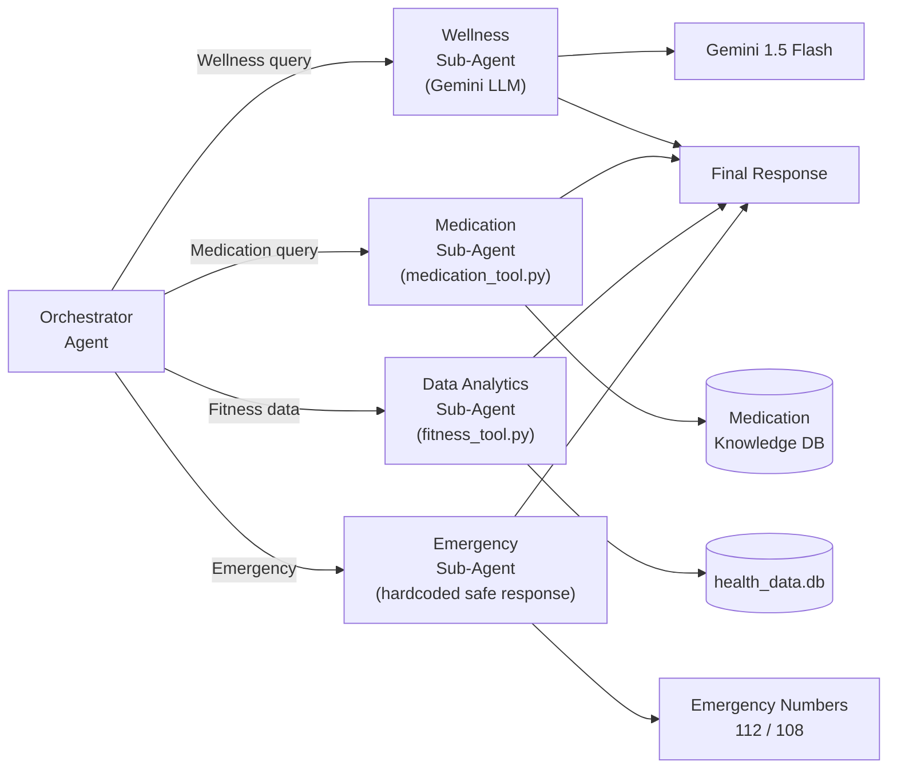

# 🩺 Aarogya-AI — Intelligent Health & Wellness Assistant

> **Safety Notice:** Aarogya-AI provides general wellness and educational information only. It does **not** diagnose diseases, prescribe medications, or replace professional medical advice. For emergencies call **112** (India).

[](https://python.org)
[](https://streamlit.io)
[](https://fastapi.tiangolo.com)
[](https://langchain.com)
[](LICENSE)

---

## 📌 Problem Statement

Millions of people lack affordable, accessible, real-time health guidance. Aarogya-AI bridges this gap by providing an AI-powered wellness companion that helps users:

- Understand general health concepts through conversational AI
- Track personal wellness metrics (weight, steps, sleep)
- Receive risk assessments and goal recommendations
- Access medication safety awareness and symptom education
- Detect wellness patterns through data analysis and RAG-powered retrieval

### Target Users
- Health-conscious individuals seeking daily wellness tracking
- Students and professionals wanting lifestyle guidance
- Caregivers needing accessible health information resources

### Measurable Success Criteria

| Metric | Target |
|--------|--------|
| AI response latency | < 5 seconds |
| Health data operations (CRUD) | 100% functional |
| API endpoint availability | 11 endpoints, all functional |
| Pages passing syntax check | 13/13 |
| Emergency guardrail trigger | Always escalates on emergency keywords |
| Test coverage (core flows) | ≥ 80% of core paths |

---

## 👥 Team & Roles

| Member | Role | Responsibilities |
|--------|------|-----------------|
| Nehab | Full-Stack Developer & AI Lead | Architecture, LangChain agent, FastAPI backend, Streamlit UI |
| Gayatri | ML Engineer & Data Analyst | Health data pipeline, analytics, risk assessment logic |
| Team | QA & Documentation | Testing, README, demo guide, deployment |

---

## 📅 Week-by-Week Deliverables Checklist

| Week | Deliverable | Status |
|------|-------------|--------|
| **W1** | Repository, problem statement, roadmap, README | ✅ Done |
| **W2** | LLM benchmarks, RAG pipeline, architecture diagram | ✅ Done |
| **W3** | Tool-calling agent (fitness, medication, symptom, goal tools) | ✅ Done |
| **W4** | End-to-end agent, multi-agent workflow, error handling & logging | ✅ Done |
| **W5** | Glassmorphism UI, multi-agent UI integration | ✅ Done |
| **W6** | FastAPI backend, auth, chat history, analytics, API docs | ✅ Done |
| **W7** | Guardrails, input validation, automated tests, latency tuning | ✅ Done |
| **W8** | Deployment config, final README, DEMO_GUIDE.md, presentation | ✅ Done |

---

## 🏗️ Architecture

### AI Agent Architecture



### Multi-Agent Workflow (A2A Communication)



### System Components

| Component | Technology | Purpose |
|-----------|------------|---------|
| Frontend | Streamlit | Multi-page wellness dashboard UI |
| Backend API | FastAPI | REST API, auth, chat history, file uploads |
| AI Brain | Google Gemini 1.5 Flash | Natural language health guidance |
| Orchestration | LangChain | Tool-calling agent, prompt chains |
| RAG Pipeline | FAISS + HuggingFace Embeddings | Health knowledge retrieval |
| Primary DB | SQLite (`health_data.db`) | User wellness data (weight, steps, sleep) |
| Backend DB | SQLite (`aarogya_week6.db`) | Users, chats, feedback, uploads |
| Auth | JWT (HS256, PyJWT) | Stateless token authentication |
| Guardrails | Custom keyword rules | Emergency/scope/injection protection |
| Deployment | Streamlit Cloud / Render | Public hosting |

---

## 🤖 LLM Benchmarks (Week 2)

| Model | Quality | Latency | Cost | Selected |
|-------|---------|---------|------|----------|
| **Gemini 1.5 Flash** | ⭐⭐⭐⭐☆ | ~1.5s | Free tier | ✅ **Yes** |
| Gemini 1.5 Pro | ⭐⭐⭐⭐⭐ | ~3.5s | Paid | Fallback |
| GPT-4o Mini | ⭐⭐⭐⭐☆ | ~2.0s | Paid | No |
| GPT-3.5 Turbo | ⭐⭐⭐☆☆ | ~1.2s | Paid | No |
| Llama 3 8B (local) | ⭐⭐⭐☆☆ | ~8s | Free | No |

**Selection rationale:** Gemini 1.5 Flash provides the best quality/latency/cost balance with a free API tier, making it ideal for a student portfolio project.

### Embedding Models (RAG Pipeline)

| Model | Dims | Latency | Selected |
|-------|------|---------|----------|
| `all-MiniLM-L6-v2` (HuggingFace) | 384 | ~50ms | ✅ **Yes** |
| `text-embedding-ada-002` (OpenAI) | 1536 | ~200ms | No (cost) |
| `gemini-embedding-004` | 768 | ~300ms | Fallback |

---

## 🔧 Integrated Agent Tools (Week 3)

| Tool | File | Trigger Keywords | Purpose |
|------|------|-----------------|---------|
| Fitness Summary | `src/fitness_tool.py` | "my health data", "steps", "sleep", "weight" | Query SQLite health_data.db and return wellness summary |
| Medication Awareness | `src/medication_tool.py` | "medication interaction", "drug interaction" | General medication safety information |
| RAG Health Info | `src/rag_pipeline.py` | All LLM queries + `/api/rag/health-info` | Retrieve relevant health knowledge chunks |
| Emergency Escalation | `backend/agent.py` | Emergency keywords | Immediate redirect to 112/108 |
| Risk Assessment | `pages/8_Risk_Assesment.py` | UI-driven form | Wellness risk scoring (sleep/steps/water/stress) |
| Health Goals | `pages/7_Health_Goals.py` | UI-driven goal setting | Daily step/sleep/weight goals + progress bars |
| Data Analytics | `pages/4_Health_Analysis.py` | Auto from DB | Trend charts and statistics |

---

## 🌐 API Endpoints (Week 6)

Base URL (local): `http://localhost:8000`  
Interactive docs: `http://localhost:8000/docs`  
Auth: Bearer JWT (obtain from `POST /api/auth/login`)

| Method | Path | Auth | Request Body | Response | Purpose |
|--------|------|------|-------------|----------|---------|
| GET | `/` | No | — | `{message, version}` | Welcome / liveness |
| GET | `/health` | No | — | `{status: ok}` | Health probe |
| POST | `/api/auth/register` | No | `{name, email, password}` | `{message, user_id}` | Register user |
| POST | `/api/auth/login` | No | `{email, password}` | `{access_token, token_type}` | Login → JWT |
| GET | `/api/auth/me` | Yes | — | `{id, name, email}` | Current user profile |
| POST | `/api/chat` | Yes | `{message}` | `{chat_id, message, response}` | AI health chat |
| GET | `/api/chat/history` | Yes | — | `{history: [...]}` | Last 50 chats |
| POST | `/api/files/upload` | Yes | Multipart file | `{message, filename}` | Upload CSV/JSON/TXT |
| POST | `/api/feedback` | Yes | `{rating, comment}` | `{message, feedback_id}` | Submit feedback |
| GET | `/api/analytics` | Yes | — | `{total_chats, total_uploads, total_feedback}` | Usage analytics |
| GET | `/api/rag/health-info` | No | `?topic=sleep` | `{topic, content}` | RAG knowledge query |
| GET | `/docs` | No | — | Swagger UI | Interactive API docs |

---

## 📁 Project Structure

```
aarogya-ai/
├── app.py                      # Streamlit entry point
├── ui.py                       # Shared UI helpers
├── requirements.txt            # Dependencies
├── .env                        # API keys (gitignored)
├── .env.example                # Key template
├── Procfile                    # Render deployment
├── render.yaml                 # Render config
├── DEMO_GUIDE.md               # Demo script + presentation
│
├── pages/                      # Streamlit pages
│   ├── home.py                 # Glassmorphism dashboard
│   ├── 2_chatbot.py            # AI Chatbot
│   ├── 3_Health_Data.py        # Health data CRUD
│   ├── 4_Health_Analysis.py    # Analytics + charts
│   ├── 5_Health_Report.py      # Wellness report + CSV
│   ├── 6_Import_Health_Data.py # CSV/JSON file import
│   ├── 7_Health_Goals.py       # Goal tracking
│   ├── 8_Risk_Assesment.py     # Wellness risk scoring
│   ├── 9_Symptom_Information.py
│   ├── 10_Health_Recommendations.py
│   ├── 11_Medication _Safety.py
│   ├── 12_Emergency_Detection.py
│   └── 13_AI_Health_Assistant.py
│
├── src/                        # Core AI modules
│   ├── chatbot.py              # LangChain + Gemini chain
│   ├── fitness_tool.py         # SQLite wellness tool
│   ├── medication_tool.py      # Medication awareness tool
│   └── rag_pipeline.py         # FAISS RAG pipeline
│
├── backend/                    # FastAPI backend
│   ├── main.py                 # API routes (11 endpoints)
│   ├── agent.py                # Orchestrator + guardrails
│   ├── database.py             # SQLite init + connection
│   ├── security.py             # JWT auth + password hashing
│   ├── aarogya_week6.db        # Backend SQLite DB
│   └── uploads/                # Uploaded files
│
├── tests/
│   └── test_core.py            # Automated tests (pytest)
│
└── health_data.db              # Wellness tracking DB
```

---

## ⚙️ Setup & Installation

### Prerequisites
- Python 3.11+
- Git

### 1. Clone the Repository
```bash
git clone https://github.com/gayatrik9620-design/aarogya-ai.git
cd aarogya-ai
```

### 2. Create Virtual Environment
```bash
python -m venv .venv
# Windows
.venv\Scripts\activate
# macOS/Linux
source .venv/bin/activate
```

### 3. Install Dependencies
```bash
pip install -r requirements.txt
```

### 4. Configure Environment Variables
```bash
cp .env.example .env
# Edit .env — add your GOOGLE_API_KEY
```

### 5. Run the Streamlit App
```bash
python -m streamlit run app.py
```

### 6. Run the FastAPI Backend (separate terminal)
```bash
uvicorn backend.main:app --reload --port 8000
```

### 7. Run Tests
```bash
python -m pytest tests/ -v
```

### 8. View API Docs
Open `http://localhost:8000/docs`

---

## 🔑 Environment Variables

| Variable | Required | Description |
|----------|----------|-------------|
| `GOOGLE_API_KEY` | ✅ Yes | Google Gemini API key from [aistudio.google.com](https://aistudio.google.com/app/apikey) |
| `JWT_SECRET_KEY` | Recommended | JWT signing secret (default: dev value — change in production) |

---

## 🚀 Deployment

### Option A: Streamlit Community Cloud (Recommended)
1. Push repo to GitHub
2. Go to [share.streamlit.io](https://share.streamlit.io)
3. Connect repo → set `app.py` as entry point
4. Add `GOOGLE_API_KEY` in Secrets settings
5. Deploy ✅

### Option B: Render
```bash
# render.yaml already included
# 1. Connect GitHub repo on render.com
# 2. Add environment variables in Render dashboard
# 3. Deploy web service
```

### Option C: Hugging Face Spaces
```bash
# 1. Create new Space → SDK: Streamlit
# 2. Push code
# 3. Add GOOGLE_API_KEY to Space Secrets
```

---

## ⚠️ Known Limitations

- Gemini API free tier has rate limits (60 req/min)
- RAG pipeline uses local FAISS index — no cloud vector store
- FastAPI backend runs separately from Streamlit (dual-process)
- Not intended for clinical or medical use
- Emergency detection is awareness-only, not real-time monitoring

---

## 🛡️ Medical Disclaimer

Aarogya-AI is an AI-based wellness and health information project for **educational and general informational purposes only**. It does **not** provide medical diagnosis, treatment recommendations, or prescriptions. Always consult a qualified healthcare professional for personal medical advice.

---

## 📄 License

MIT License — see [LICENSE](LICENSE) for details.